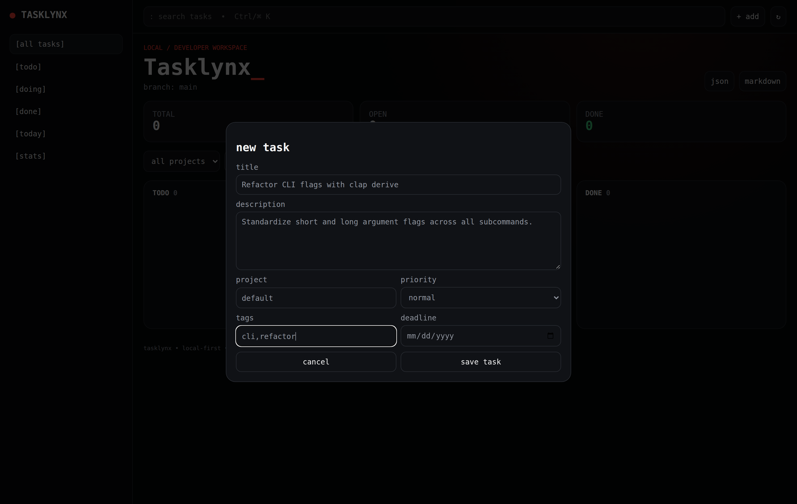
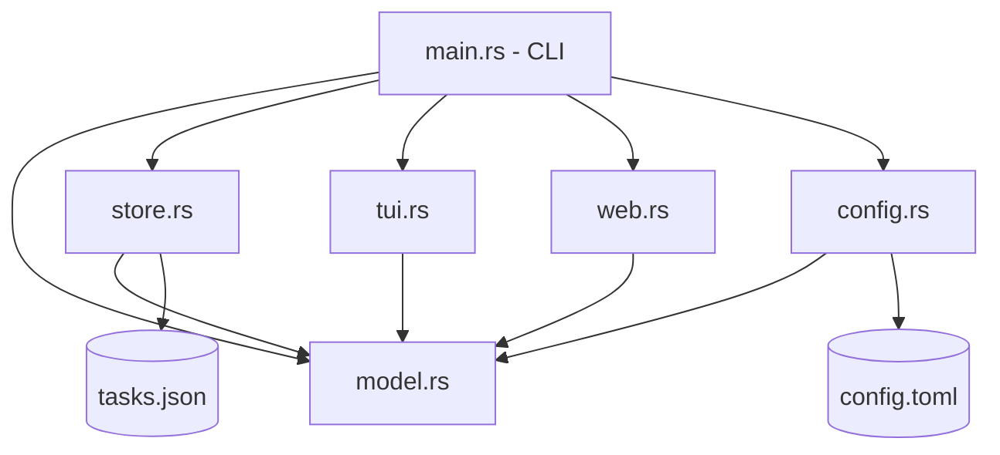

<p align="center">
  
</p>

<h1 align="center">Tasklynx</h1>

<p align="center">
  <strong>Developer-first local task manager with Git-style workflows, terminal Kanban board, and responsive web dashboard.</strong>
</p>

<p align="center">
  
  
  
  
  
</p>

## Overview

Tasklynx is a local-first task manager built in Rust (`edition = "2021"`) with `clap` CLI, `ratatui`/`crossterm` TUI, and `axum` web dashboard. Tasks are stored as atomic JSON in the platform data directory with Git-style branch scoping. It supports projects, tags, priorities, due dates, search, export (JSON/Markdown), and self-update/uninstall.

## Screenshot

<p align="center">
  
</p>

<p align="center">
  <em>More screenshots:
    <a href="docs/screenshots.md">View all screenshots</a>
  </em>
</p>

## Table of Contents

- [Key Features](#key-features)
- [Installation](#installation)
- [Quick Start](#quick-start)
- [Usage Examples](#usage-examples)
- [Documentation](#documentation)
- [Interface](#interface)
- [Architecture](#architecture)
- [Requirements](#requirements)
- [Prerequisites](#prerequisites)
- [Development](#development)
- [Contributing](#contributing)
- [Security](#security)
- [License](#license)

## Key Features

- `tasklynx` / `tx` CLI with subcommands (init, add, list, complete, reopen, doing, delete, edit, duplicate, search, today, stats, branch, export, web, board, config, self)
- Ratatui terminal Kanban board (`tx board`)
- Local atomic JSON persistence via `src/store.rs`
- Git-style task branches (list/create/switch/delete)
- Projects, tags, priorities (`low|normal|high|urgent`), due dates with overdue detection
- Search, agenda (`tx today`), statistics
- Task editing/duplication, branch-scoped filtering
- JSON and Markdown export
- Embedded responsive web dashboard (`src/web.rs`, `assets/index.html`)
- Configurable web/theme options (`src/config.rs`, `src/model.rs`)
- Embedded web assets (single binary)
- Windows icon embedding via `build.rs`
- Cross-platform release targets
- Self update/uninstall (`tx self update|uninstall`)
- Installers (`installer.sh`, `installer.ps1`)

## Installation

### One-line installer (Linux/macOS)
```bash
curl -fsSL https://raw.githubusercontent.com/peekstore/tasklynx/main/installer.sh | sh
```

### One-line installer (Windows PowerShell)
```powershell
irm https://raw.githubusercontent.com/peekstore/tasklynx/main/installer.ps1 | iex
```

### From crates.io <!-- TODO: fill -->
<!-- TODO: fill --> `cargo install tasklynx` (not verified)

### From source
```bash
git clone https://github.com/peekstore/tasklynx.git
cd tasklynx
cargo build --release
```

## Quick Start

```bash
tx init
tx add "Fix login bug" --project website --tag bug,auth --priority high
tx list
tx board
tx web
```

## Usage Examples

```bash
# Branching
tx branch create feature/auth
tx branch switch feature/auth

# Editing
tx edit <id> --priority urgent --add-tag blocking

# Search and agenda
tx search auth
tx today

# Export
tx export --format md
tx export --format json

# Web
tx web --host 127.0.0.1 --port 8787
```

## Documentation

| Document | Description |
| --- | --- |
| [docs/index.md](docs/index.md) | Documentation home |
| [docs/getting-started.md](docs/getting-started.md) | Setup and first steps |
| [docs/installation.md](docs/installation.md) | Installation methods |
| [docs/cli.md](docs/cli.md) | CLI command reference |
| [docs/configuration.md](docs/configuration.md) | Configuration and theming |
| [docs/architecture.md](docs/architecture.md) | Codebase architecture |
| [docs/development.md](docs/development.md) | Development workflow |
| [docs/deployment.md](docs/deployment.md) | Release/deployment |
| [docs/screenshots.md](docs/screenshots.md) | Screenshots gallery |
| [docs/troubleshooting.md](docs/troubleshooting.md) | Troubleshooting |
| [docs/faq.md](docs/faq.md) | Frequently asked questions |

## Interface

- **CLI**: `tasklynx` / `tx` (clap derive)
- **TUI**: ratatui Kanban board
- **Web**: Axum server serving embedded HTML/JS

## Architecture



Source files: `src/main.rs`, `src/model.rs`, `src/store.rs`, `src/tui.rs`, `src/web.rs`, `src/config.rs`, `build.rs`.

## Requirements

- Rust toolchain (see `Cargo.toml` edition 2021)
- Dependencies as in `Cargo.toml`

## Prerequisites

- `cargo`, `rustc` for building from source

## Development

```bash
git clone https://github.com/peekstore/tasklynx.git
cd tasklynx
cargo build
cargo test
cargo clippy --all-targets -- -D warnings
cargo fmt --all -- --check
cargo run -- --help
```

## Contributing

See [CONTRIBUTING.md](CONTRIBUTING.md).

## Security

See [SECURITY.md](SECURITY.md).

## License

[MIT](LICENSE) © 2026 RK Riad Khan

## NixOS / Nix

```bash
# Run directly
nix run github:peekstore/tasklynx

# Install to profile
nix profile install github:peekstore/tasklynx

# Or add to flake.nix
```

## Android (Termux)

```bash
curl -fsSL https://raw.githubusercontent.com/peekstore/tasklynx/main/installer.sh | sh
```

## MiXOS

```bash
./build-mixos.sh
```
