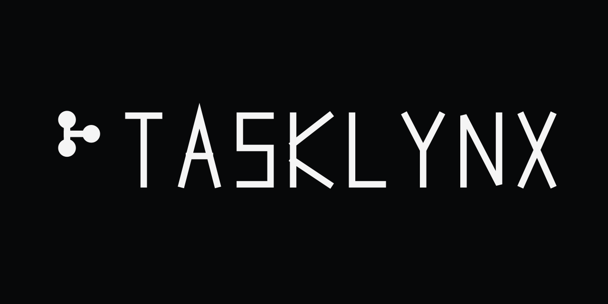
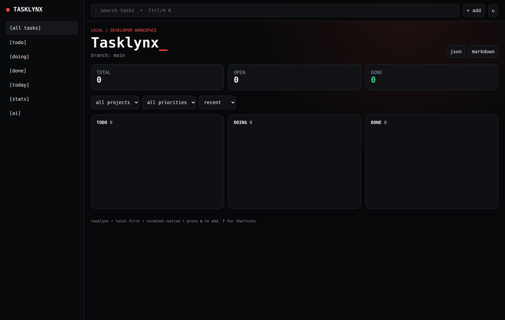
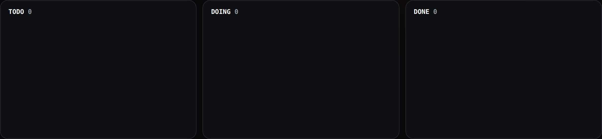
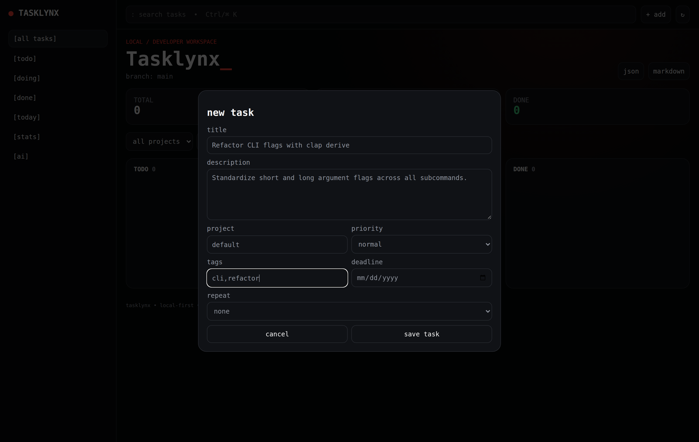

<div align="center">
  <picture>
    <source media="(prefers-color-scheme: dark)" srcset="Tasklynx-logos/banner-on-dark-mode-1280x640.png">
    <source media="(prefers-color-scheme: light)" srcset="Tasklynx-logos/banner-on-light-mode-1280x640.png">
    
  </picture>

  <h1>Tasklynx</h1>

  <p><strong>A local-first task manager for developers — Git-style branches, a terminal Kanban board, and a fast web dashboard.</strong></p>

  <p>
    <a href="https://github.com/peekstore/tasklynx/releases"></a>
    <a href="https://github.com/peekstore/tasklynx/actions/workflows/ci.yml"></a>
    <a href="LICENSE"></a>
    <a href="https://peekstore.github.io/tasklynx/llms.txt"></a>
    
  </p>

  <p>
    <a href="https://peekstore.github.io/tasklynx/">Documentation</a> ·
    <a href="https://peekstore.github.io/tasklynx/llms.txt">AI Reader</a> ·
    <a href="https://github.com/peekstore/tasklynx/releases">Releases</a> ·
    <a href="https://github.com/peekstore/tasklynx/issues">Issues</a> ·
    <a href="https://github.com/peekstore/tasklynx/tree/main/docs">Docs source</a>
  </p>
</div>

---

## Overview

Tasklynx keeps your tasks in a single local JSON file, with no account, no daemon, and no network dependency for core task management. It borrows the parts of a Git workflow that are useful for planning — branches for parallel streams of work, short prefix IDs, and fast filtering — and gives you three ways to use it:

- **CLI** (`tasklynx` or the short alias `tx`) for scripting and quick capture.
- **TUI** (`tx board`) for an interactive Kanban board in the terminal.
- **Web** (`tx web`) for a responsive browser dashboard on `127.0.0.1`.

Everything is written atomically to disk, so a crash can't leave a half-written task store.

## Features

- **Local-first** — tasks live on your machine; nothing is sent anywhere unless you explicitly run an AI command.
- **Git-style branches** — keep work for different features or releases separate.
- **Short IDs** — any unique prefix of a task UUID works in commands.
- **Priorities and due dates** — `low`, `normal`, `high`, `urgent`, with overdue detection.
- **Projects and tags** — group work and filter instantly.
- **Three interfaces** — CLI, terminal Kanban TUI, and a web dashboard.
- **Export** — JSON or Markdown for backups and sharing.
- **Opt-in AI planning** — draft task plans and subtask breakdowns with local Ollama or OpenAI-compatible providers behind the `ai` build feature.
- **Cross-platform** — Linux, macOS, Windows, and Android (Termux), with ARM and x86 builds.
- **Single binary** — no runtime dependencies; `tx self update` keeps it current.

## Screenshots

<div align="center">
  
</div>

| Kanban Board | Task Modal Editor |
| :---: | :---: |
|  |  |

More images and descriptions in the [screenshots gallery](https://peekstore.github.io/tasklynx/screenshots/).

## Installation

### Package managers

| Manager | Platform | Command |
| --- | --- | --- |
| **APT** | Debian / Ubuntu | `curl -LO https://github.com/peekstore/tasklynx/releases/download/v0.0.1-beta-1/tasklynx_0.0.1-beta-1_amd64.deb && sudo apt install ./tasklynx_0.0.1-beta-1_amd64.deb` |
| **npm** | Cross-platform | `npm install -g tasklynx` / `npx tasklynx` |
| **pipx** | Cross-platform | `pipx install git+https://github.com/peekstore/tasklynx.git#subdirectory=packaging/pipx` |
| **Chocolatey** | Windows | `choco install tasklynx` |
| **Cargo** | Universal (Rust) | `cargo install --git https://github.com/peekstore/tasklynx.git --locked` |

### One-line installer

#### Linux / macOS / Termux

```bash
curl -fsSL https://raw.githubusercontent.com/peekstore/tasklynx/main/installer.sh | sh
```

The installer places `tasklynx` and the `tx` alias in `${XDG_CONFIG_HOME:-$HOME/.config}/peekstore/tasklynx/bin` and adds that directory to your shell `PATH`.

Pin a specific version:

```bash
TASKLYNX_VERSION=v0.0.1-beta-1 \
  curl -fsSL https://raw.githubusercontent.com/peekstore/tasklynx/main/installer.sh | sh
```

#### Windows (PowerShell)

```powershell
irm https://raw.githubusercontent.com/peekstore/tasklynx/main/installer.ps1 | iex
```

The installer writes to `%USERPROFILE%\.config\peekstore\tasklynx\bin`, updates `PATH`, and creates a Start Menu shortcut.

#### Android (Termux)

Install [Termux](https://termux.dev/) from F-Droid, then run the Linux installer:

```bash
pkg install curl
curl -fsSL https://raw.githubusercontent.com/peekstore/tasklynx/main/installer.sh | sh
```

The installer detects your CPU ABI (`arm64-v8a`, `armeabi-v7a`, or `x86_64`) and downloads the matching build.

### Manual download

Download standalone binaries or archives from [Releases](https://github.com/peekstore/tasklynx/releases) and place them on your `PATH`. Verify checksums with:

```bash
sha256sum -c SHA256SUMS.txt
```

### From source

```bash
git clone https://github.com/peekstore/tasklynx.git
cd tasklynx
cargo build --release
install -Dm755 target/release/tasklynx ~/.local/bin/tasklynx
```

Requires Rust 1.70 or newer.

## Quick start

```bash
tx init                                              # create the data store and config
tx add "Implement authentication" \
  --project api --tag backend,auth --priority high --due 2026-12-31
tx add --template review                             # apply a task template
tx list                                              # tasks on the current branch
tx board                                             # terminal Kanban board
tx web                                               # dashboard at http://127.0.0.1:8787
tx doing <id>                                        # mark a task in progress
tx start <id>                                        # start a local timer
tx stop                                              # stop the timer
tx time <id>                                         # estimate versus actual
tx complete <id>                                     # mark a task done
tx next                                              # best next task
tx git status                                        # Git branch and task context
```

### Branches

```bash
tx branch create feature-auth
tx branch switch feature-auth
tx list                    # only tasks on feature-auth
tx list --all              # tasks on every branch
tx branch switch main
tx branch delete feature-auth
```

### Templates, views, and bulk actions

```bash
tx add --template review
tx list --save api --project api
tx list --view api
tx complete --done-before 2026-10-31
tx duplicates
```

Templates fill in common task fields. Saved views keep frequently used filters in `config.toml`, bulk completion closes overdue work in one undoable step, and `tx duplicates` flags similar open titles.

### Time tracking

```bash
tx add "Write migration" --estimate 45
tx start <id>
tx stop
tx time
tx time <id>
```

Timers are local and daemon-free. Only one runs at a time; completing or deleting a task stops its active timer automatically.

### Search, reminders, export, and stats

```bash
tx search auth
tx today
tx remind --days 7
tx remind --notify
tx stats
tx export --format json > tasks.json
tx export --format md > TASKS.md
tx export --format ics > tasklynx.ics
```

## CLI at a glance

| Command | Description |
| --- | --- |
| `tx init` | Initialize the data store and config |
| `tx add <title>` | Add a task (`--project`, `--tag`, `--priority`, `--due`, `--estimate`, `--template`) |
| `tx list` | List tasks (`--project`, `--tag`, `--status`, `--search`, `--all`, `--view`) |
| `tx view <save\|list\|show\|run\|delete>` | Manage saved filters |
| `tx doing <id>` | Mark a task in progress |
| `tx start <id>` / `tx stop` | Track time locally |
| `tx time [id]` | Show tracked time versus estimates |
| `tx complete <id>` | Mark a task done |
| `tx complete --done-before <date>` | Bulk-complete due work |
| `tx reopen <id>` | Reopen a completed task |
| `tx next` | Show the best next task to work on |
| `tx edit <id>` | Edit title, description, priority, project, due date, or tags |
| `tx duplicate <id>` | Duplicate a task |
| `tx duplicates` | Find similar task titles |
| `tx delete <id>` | Move a task to trash |
| `tx undo` | Undo the most recent CLI mutation |
| `tx trash <list\|restore\|purge>` | Manage deleted tasks |
| `tx block <id> --by <id>` | Add a task dependency |
| `tx subtask <parent> <title>` | Create a subtask |
| `tx tree` | Show subtask trees |
| `tx search <query>` | Search titles, descriptions, and tags |
| `tx today` | Show tasks due today or overdue |
| `tx agenda` | Show upcoming, overdue, and recurring work |
| `tx remind` | Show due and overdue work (`--days`, opt-in `--notify`) |
| `tx stats` | Show task and branch totals |
| `tx branch <list\|create\|switch\|delete>` | Manage branches |
| `tx git ...` | Inspect Git context, link commits, scan TODOs, and manage commit hooks |
| `tx ai plan <goal>` | Draft a task plan with an opt-in AI provider |
| `tx ai breakdown <id>` | Draft subtasks for an existing task |
| `tx ai triage` | Rank next tasks with offline fallback |
| `tx ai standup` / `tx ai review` | Summarize recent or branch work |
| `tx ai ask <question>` | Ask a question about task context |
| `tx ai doctor` | Check AI provider and model configuration |
| `tx export --format <json\|md\|ics>` | Export tasks |
| `tx board` | Open the terminal Kanban board |
| `tx web` | Start the web dashboard |
| `tx config <init\|show>` | Manage configuration |
| `tx self <update\|uninstall>` | Manage the installation |

Run `tx <command> --help` for the full flag list. See the [CLI reference](https://peekstore.github.io/tasklynx/cli/).

## Configuration

Configuration lives at:

```
~/.config/peekstore/tasklynx/config.toml
```

On Windows this is `%USERPROFILE%\.config\peekstore\tasklynx\config.toml`; on macOS the same `~/.config` convention is used. `XDG_CONFIG_HOME` is respected.

Create or inspect it with:

```bash
tx config init
tx config show
```

```toml
host = "127.0.0.1"
port = 8787
accent = "#ff453a"
background = "#070809"
panel = "#101216"
foreground = "#f5f5f5"
muted = "#8f949e"
font_family = "ui-monospace, SFMono-Regular, Menlo, Consolas, monospace"
default_project = "default"

[ai]
provider = "none"
model = "llama3.1"
endpoint = "http://127.0.0.1:11434"
max_context_tasks = 50
include_descriptions = true
redact = true
```

### AI providers

AI is disabled by default. To use it, build with the optional networking feature and select a provider:

```bash
cargo build --features ai

# config.toml
[ai]
provider = "ollama"
model = "llama3.1"
endpoint = "http://127.0.0.1:11434"
```

The `ollama` and `openai-compatible` providers require a feature-enabled build. For hosted OpenAI-compatible endpoints, set `TASKLYNX_AI_API_KEY` in the environment instead of writing keys to `config.toml`. Use `tx ai doctor` to verify reachability and model availability.

Google Gemini through AI Studio works through the OpenAI-compatible provider:

```toml
[ai]
provider = "openai-compatible"
model = "gemini-2.5-flash"
endpoint = "https://generativelanguage.googleapis.com/v1beta/openai"
```

Preview AI plans before writing them:

```bash
tx ai plan "Ship the billing API"
tx ai plan "Ship the billing API" --apply
tx ai breakdown <id>
tx ai breakdown <id> --apply
tx ai triage
tx ai standup --days 1
tx ai review feature-auth
tx ai ask "What should I do next?"
```

Triage falls back to deterministic `tx next` ranking when no provider is configured. The web dashboard has an AI copilot panel with preview and apply controls, and the terminal board exposes triage and breakdown previews in its detail pane. Use `TASKLYNX_AI_LOG=1` to log prompt sizes and latency without logging prompt contents.

### Data storage

Tasks are stored as `tasks.json`:

| Platform | Path |
| --- | --- |
| Linux | `~/.local/share/tasklynx/tasks.json` |
| macOS | `~/Library/Application Support/tasklynx/tasks.json` |
| Windows | `%LOCALAPPDATA%\tasklynx\tasks.json` |

Set `TASKLYNX_HOME` to relocate the store; the file is written to `$TASKLYNX_HOME/tasklynx/tasks.json`.

## Development

```bash
cargo build
cargo test
cargo test --all-targets --features ai
cargo clippy --all-targets -- -D warnings
cargo clippy --all-targets --features ai -- -D warnings
cargo fmt --all -- --check
```

See [CONTRIBUTING.md](CONTRIBUTING.md) for the workflow and [docs/development.md](docs/development.md) for project layout and the release process.

## Contributing

Contributions are welcome. Please read [CONTRIBUTING.md](CONTRIBUTING.md) and [CODE_OF_CONDUCT.md](CODE_OF_CONDUCT.md) first. For security issues, follow [SECURITY.md](SECURITY.md).

## Brand assets

Logos, icons, and banners live in [`Tasklynx-logos/`](Tasklynx-logos). Use them for articles, packages, and integrations.

## License

Released under the [MIT License](LICENSE). Copyright © 2026 [RK Riad Khan](https://rkriad585.github.io).

<div align="center">
  <sub>
    Built with ❤️ by <a href="https://github.com/rkriad585">RK Riad Khan</a> (<a href="https://rkriad585.github.io">Website</a>) at <a href="https://github.com/peekstore">peekstore</a> ·
    <a href="https://peekstore.github.io">peekstore.github.io</a> ·
    <a href="https://peekstore.github.io/tasklynx">Documentation</a>
  </sub>
</div>
