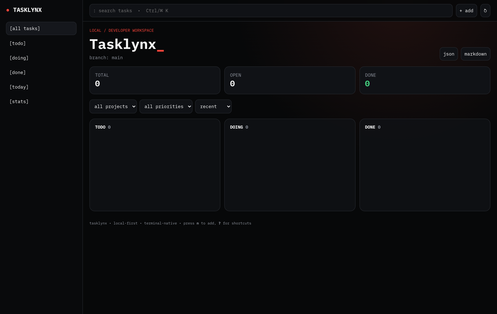
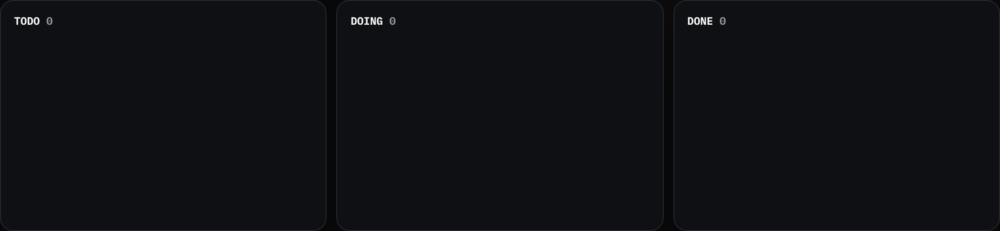

<div align="center">
  <a href="https://github.com/peekstore/tasklynx">
    
  </a>

  <h1>Tasklynx</h1>

  <p><strong>A local-first task manager for developers — Git-style branches, a terminal Kanban board, and a fast web dashboard.</strong></p>

  <p>
    <a href="https://github.com/peekstore/tasklynx/releases/latest"></a>
    <a href="https://github.com/peekstore/tasklynx/actions/workflows/ci.yml"></a>
    <a href="LICENSE"></a>
    
  </p>

  <p>
    <a href="https://peekstore.github.io/tasklynx/">Documentation</a> ·
    <a href="https://github.com/peekstore/tasklynx/releases">Releases</a> ·
    <a href="https://github.com/peekstore/tasklynx/issues">Issues</a> ·
    <a href="https://github.com/peekstore/tasklynx/tree/main/docs">Docs source</a>
  </p>
</div>

---

## Overview

Tasklynx keeps your tasks in a single local JSON file, with no account, no daemon, and no network dependency. It borrows the parts of a Git workflow that are useful for planning — branches for parallel streams of work, short prefix IDs, and fast filtering — and gives you three ways to use it:

- **CLI** (`tasklynx` or the short alias `tx`) for scripting and quick capture.
- **TUI** (`tx board`) for an interactive Kanban board in the terminal.
- **Web** (`tx web`) for a responsive browser dashboard on `127.0.0.1`.

Everything is written atomically to disk, so a crash can't leave a half-written task store.

## Features

- **Local-first** — tasks live on your machine; nothing is sent anywhere.
- **Git-style branches** — keep work for different features or releases separate.
- **Short IDs** — any unique prefix of a task UUID works in commands.
- **Priorities and due dates** — `low`, `normal`, `high`, `urgent`, with overdue detection.
- **Projects and tags** — group work and filter instantly.
- **Three interfaces** — CLI, terminal Kanban TUI, and a web dashboard.
- **Export** — JSON or Markdown for backups and sharing.
- **Cross-platform** — Linux, macOS, Windows, and Android (Termux), with ARM and x86 builds.
- **Single binary** — no runtime dependencies; `tx self update` keeps it current.

## Screenshots

<div align="center">
  
</div>

| Kanban Board | Task Modal Editor |
| :---: | :---: |
|  |  |

More images and descriptions in the [screenshots gallery](https://peekstore.github.io/tasklynx/screenshots/).

## Installation

### Package managers

| Manager | Platform | Command |
| --- | --- | --- |
| **Homebrew** | macOS / Linux | `brew install peekstore/tasklynx/tasklynx` |
| **mise** | Linux / macOS | `mise use -g ubi:peekstore/tasklynx` |
| **Pacman** | Arch Linux | `cd packaging/pacman && makepkg -si` |
| **APT** | Debian / Ubuntu | `sudo apt install ./tasklynx_0.0.1-beta-2_amd64.deb` |
| **npm** | Cross-platform | `npm install -g tasklynx` / `npx tasklynx` |
| **pipx** | Cross-platform | `pipx install git+https://github.com/peekstore/tasklynx.git#subdirectory=packaging/pipx` |
| **Winget** | Windows | `winget install peekstore.tasklynx` |
| **Scoop** | Windows | `scoop bucket add tasklynx https://github.com/peekstore/tasklynx && scoop install tasklynx` |
| **Chocolatey** | Windows | `choco install tasklynx` |
| **Nix** | Linux / macOS | `nix run github:peekstore/tasklynx` |

### One-line installer

#### Linux / macOS / Termux

```bash
curl -fsSL https://raw.githubusercontent.com/peekstore/tasklynx/main/installer.sh | sh
```

The installer places `tasklynx` and the `tx` alias in `${XDG_CONFIG_HOME:-$HOME/.config}/peekstore/tasklynx/bin` and adds that directory to your shell `PATH`.

Pin a specific version:

```bash
TASKLYNX_VERSION=v0.0.1-beta-2 \
  curl -fsSL https://raw.githubusercontent.com/peekstore/tasklynx/main/installer.sh | sh
```

#### Windows (PowerShell)

```powershell
irm https://raw.githubusercontent.com/peekstore/tasklynx/main/installer.ps1 | iex
```

The installer writes to `%USERPROFILE%\.config\peekstore\tasklynx\bin`, updates `PATH`, and creates a Start Menu shortcut.

#### Android (Termux)

Install [Termux](https://termux.dev/) from F-Droid, then run the Linux installer:

```bash
pkg install curl
curl -fsSL https://raw.githubusercontent.com/peekstore/tasklynx/main/installer.sh | sh
```

The installer detects your CPU ABI (`arm64-v8a`, `armeabi-v7a`, or `x86_64`) and downloads the matching build.

### Manual download

Download standalone binaries or archives from [Releases](https://github.com/peekstore/tasklynx/releases) and place them on your `PATH`. Verify checksums with:

```bash
sha256sum -c SHA256SUMS.txt
```

### From source

```bash
git clone https://github.com/peekstore/tasklynx.git
cd tasklynx
cargo build --release
install -Dm755 target/release/tasklynx ~/.local/bin/tasklynx
```

Requires Rust 1.70 or newer.

## Quick start

```bash
tx init                                              # create the data store and config
tx add "Implement authentication" \
  --project api --tag backend,auth --priority high --due 2026-12-31
tx list                                              # tasks on the current branch
tx board                                             # terminal Kanban board
tx web                                               # dashboard at http://127.0.0.1:8787
tx doing <id>                                        # mark a task in progress
tx complete <id>                                     # mark a task done
```

### Branches

```bash
tx branch create feature-auth
tx branch switch feature-auth
tx list                    # only tasks on feature-auth
tx list --all              # tasks on every branch
tx branch switch main
tx branch delete feature-auth
```

### Search, export, and stats

```bash
tx search auth
tx today
tx stats
tx export --format json > tasks.json
tx export --format md > TASKS.md
```

## CLI at a glance

| Command | Description |
| --- | --- |
| `tx init` | Initialize the data store and config |
| `tx add <title>` | Add a task (`--project`, `--tag`, `--priority`, `--due`) |
| `tx list` | List tasks (`--project`, `--tag`, `--status`, `--search`, `--all`) |
| `tx doing <id>` | Mark a task in progress |
| `tx complete <id>` | Mark a task done |
| `tx reopen <id>` | Reopen a completed task |
| `tx edit <id>` | Edit title, description, priority, project, due date, or tags |
| `tx duplicate <id>` | Duplicate a task |
| `tx delete <id>` | Delete a task |
| `tx search <query>` | Search titles, descriptions, and tags |
| `tx today` | Show tasks due today or overdue |
| `tx stats` | Show task and branch totals |
| `tx branch <list\|create\|switch\|delete>` | Manage branches |
| `tx export --format <json\|md>` | Export tasks |
| `tx board` | Open the terminal Kanban board |
| `tx web` | Start the web dashboard |
| `tx config <init\|show>` | Manage configuration |
| `tx self <update\|uninstall>` | Manage the installation |

Run `tx <command> --help` for the full flag list. See the [CLI reference](https://peekstore.github.io/tasklynx/cli/).

## Configuration

Configuration lives at:

```
~/.config/peekstore/tasklynx/config.toml
```

On Windows this is `%USERPROFILE%\.config\peekstore\tasklynx\config.toml`; on macOS the same `~/.config` convention is used. `XDG_CONFIG_HOME` is respected.

Create or inspect it with:

```bash
tx config init
tx config show
```

```toml
host = "127.0.0.1"
port = 8787
accent = "#ff453a"
background = "#070809"
panel = "#101216"
foreground = "#f5f5f5"
muted = "#8f949e"
font_family = "ui-monospace, SFMono-Regular, Menlo, Consolas, monospace"
default_project = "default"
```

### Data storage

Tasks are stored as `tasks.json`:

| Platform | Path |
| --- | --- |
| Linux | `~/.local/share/tasklynx/tasks.json` |
| macOS | `~/Library/Application Support/tasklynx/tasks.json` |
| Windows | `%LOCALAPPDATA%\tasklynx\tasks.json` |

Set `TASKLYNX_HOME` to relocate the store; the file is written to `$TASKLYNX_HOME/tasklynx/tasks.json`.

## Development

```bash
cargo build
cargo test
cargo clippy --all-targets -- -D warnings
cargo fmt --all -- --check
```

See [CONTRIBUTING.md](CONTRIBUTING.md) for the workflow and [docs/development.md](docs/development.md) for project layout and the release process.

## Contributing

Contributions are welcome. Please read [CONTRIBUTING.md](CONTRIBUTING.md) and [CODE_OF_CONDUCT.md](CODE_OF_CONDUCT.md) first. For security issues, follow [SECURITY.md](SECURITY.md).

## Brand assets

Logos, icons, and banners live in [`tasklynx-logos/`](tasklynx-logos). Use them for articles, packages, and integrations.

## License

Released under the [MIT License](LICENSE). Copyright © 2026 [RK Riad Khan](https://github.com/rkriad585).

<div align="center">
  <sub>
    Built by <a href="https://github.com/peekstore">peekstore</a> ·
    <a href="https://peekstore.github.io">Website</a> ·
    <a href="https://peekstore.github.io/tasklynx">Docs</a>
  </sub>
</div>
