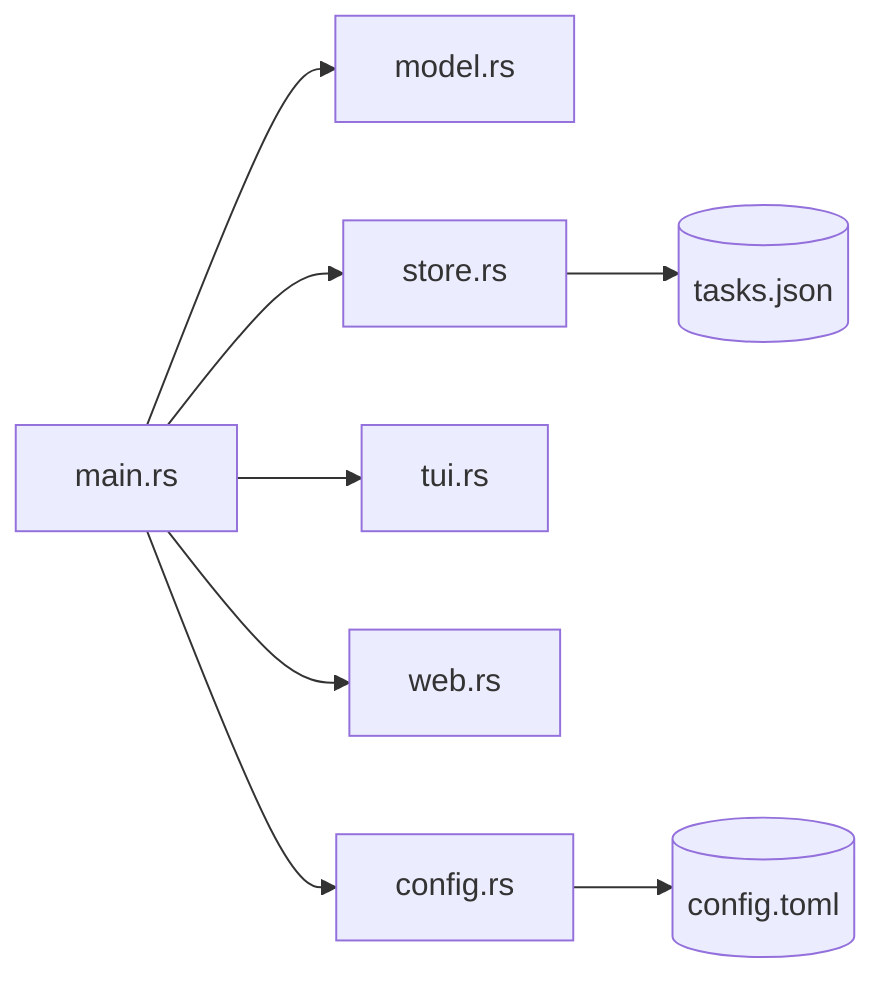

# Architecture

Tasklynx is a small synchronous CLI with two optional front ends. This page describes the module layout, data flow, and storage guarantees.

## Modules

| File | Purpose |
| --- | --- |
| `src/main.rs` | Clap definitions, command dispatch, and user-facing output |
| `src/model.rs` | `Task`, `Status`, `Priority`, `ProjectData`, `AppConfig`, date parsing |
| `src/store.rs` | JSON load/save with atomic writes, lookup helpers, export |
| `src/config.rs` | Config load/save and path resolution |
| `src/tui.rs` | Ratatui terminal Kanban board |
| `src/web.rs` | Axum server, REST endpoints, embedded assets |
| `build.rs` | Windows icon embedding |

## Data flow



`main.rs` loads `ProjectData` once, dispatches the subcommand, mutates the in-memory model, and saves it back. The TUI and web server receive a snapshot of the same data; the web server holds it behind a mutex and persists changes on each write.

## Data model

`ProjectData` is the root document:

```json
{
  "version": 1,
  "current_branch": "main",
  "branches": ["main"],
  "tasks": []
}
```

Each `Task` carries an ID, title, description, status (`todo`/`doing`/`done`), priority (`low`/`normal`/`high`/`urgent`), project, branch, tags, optional due date, and timestamps.

Serde deserialization uses defaults for missing fields, so older stores keep loading as the schema grows. `version` exists to support future migrations.

## Storage guarantees

- **One file** — `tasks.json` in the platform data directory, or under `TASKLYNX_HOME`.
- **Atomic writes** — the store serializes to `tasks.json.tmp`, then renames over the target. A crash cannot leave a partially written file.
- **No locking across processes** — concurrent writers are last-write-wins. Do not run multiple mutating commands against the same store at once.

## Config

Config is separate from data:

- `~/.config/peekstore/tasklynx/config.toml` (or `$XDG_CONFIG_HOME/...`).
- Missing or unreadable config falls back to `AppConfig::default()`.

## Web server

- Built on `axum` and `tokio`.
- Serves a single embedded HTML page and SVG favicon via `include_str!`, so the binary is self-contained.
- JSON API: `GET /api/tasks`, `POST /api/tasks`, `PUT /api/tasks/{id}`.
- Binds to `127.0.0.1:8787` by default; there is no authentication by design.

## TUI

- Built on `ratatui` and `crossterm`.
- Renders three columns (Todo, Doing, Done) and requires no mouse.

## Design constraints

- **Single binary** — no runtime assets or plugin system.
- **Local-first** — no network calls at runtime; `tx self update` shells out to the installer explicitly.
- **Small dependency surface** — clap, serde, chrono, uuid, anyhow, dirs, ratatui, crossterm, axum, tokio, toml.

[Back to README](https://github.com/peekstore/tasklynx/blob/main/README.md)
