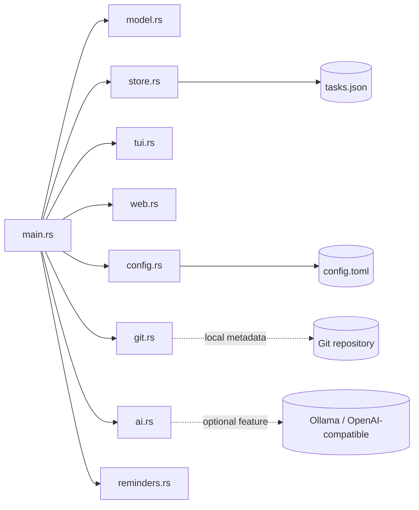

# Architecture

Tasklynx is a small synchronous CLI with two optional front ends. This page describes the module layout, data flow, and storage guarantees.

## Modules

| File | Purpose |
| --- | --- |
| `src/main.rs` | Clap definitions, command dispatch, and user-facing output |
| `src/model.rs` | `Task`, `Status`, `Priority`, `ProjectData`, `AppConfig`, date parsing |
| `src/store.rs` | JSON load/save with atomic writes, lookup helpers, export |
| `src/reminders.rs` | Due-task reminders, desktop notifications, and iCalendar export |
| `src/config.rs` | Config load/save and path resolution |
| `src/templates.rs` | Built-in task templates for `tx add --template` |
| `src/duplicates.rs` | Normalized title similarity and duplicate detection |
| `src/git.rs` | Repository discovery, branch mapping, commit scanning, and hooks |
| `src/ai.rs` | Provider abstraction, prompt building, response validation, redaction |
| `src/tui.rs` | Ratatui terminal Kanban board |
| `src/web.rs` | Axum server, REST endpoints, embedded assets |
| `build.rs` | Windows icon embedding |

## Data flow



`main.rs` loads `ProjectData` once, dispatches the subcommand, mutates the in-memory model, and saves it back. The TUI and web server receive a snapshot of the same data; the web server holds it behind a mutex and persists changes on each write.

## Data model

`ProjectData` is the root document:

```json
{
  "version": 1,
  "current_branch": "main",
  "branches": ["main"],
  "tasks": []
}
```

Each `Task` carries an ID, title, description, status (`todo`/`doing`/`done`), priority (`low`/`normal`/`high`/`urgent`), project, branch, tags, optional due date, optional estimate, local time entries, timestamps, recurrence settings, blocker and subtask links, Git source metadata, and optional commit/PR/issue URLs. A time entry with no end timestamp is the active timer.

Serde deserialization uses defaults for missing fields, so older stores keep loading as the schema grows. `version` exists to support future migrations.

## Storage guarantees

- **One file** — `tasks.json` in the platform data directory, or under `TASKLYNX_HOME`.
- **Atomic writes & durability** — the store serializes to `tasks.json.tmp`, calls `sync_all()` for filesystem durability, and renames over the target. A crash cannot leave a partially written file.
- **Cross-process safety** — mutating operations acquire an advisory file lock (`.lock`) with timeout and stale-lock recovery, preventing race conditions between concurrent CLI or web server instances.

## Config

Saved list views are stored in `config.toml` under `[views.<name>]`. They contain optional project, tag, status, and search filters plus the branch scope.

Config is separate from data:

- `~/.config/peekstore/tasklynx/config.toml` (or `$XDG_CONFIG_HOME/...`).
- Missing or partial config safely falls back to `AppConfig::default()`.
- The `[git]` table controls branch mapping, automatic Git metadata on `tx add`, and commit linking.
- The `[ai]` table controls opt-in provider selection, model, endpoint, context limits, and redaction.

## AI planning

- `src/ai.rs` defines a small `Provider` trait and an offline `none` provider.
- `ollama` and `openai-compatible` HTTP providers are compiled only with the `ai` Cargo feature.
- Default builds, including official release binaries, make no AI network calls and have no HTTP client dependency. Provider-backed AI requires a source build with `--features ai`.
- Prompt context defaults to open tasks on the current branch, can be narrowed with `--project` or `--branch`, and is capped by `ai.max_context_tasks`.
- Common secrets are redacted when `ai.redact` is enabled.
- AI responses are parsed into a strict JSON schema and validated before any task is created.
- `tx ai plan` and `tx ai breakdown` preview by default; `--apply` is required to persist tasks.
- `tx ai triage` falls back to the deterministic `tx next` ranking when no provider is configured; AI triage output must resolve to known task IDs.
- `tx ai standup`, `tx ai review`, and `tx ai ask` return validated reports/answers and never mutate the store.
- Web AI endpoints generate previews and use separate apply endpoints for plan and breakdown drafts.

## Web server

- Built on `axum` and `tokio`.
- Serves an embedded single-page application and SVG favicon via `include_str!`, keeping the binary fully self-contained.
- JSON API: `GET /api/tasks`, `POST /api/tasks`, `PUT /api/tasks/{id}`, `DELETE /api/tasks/{id}`.
- AI API: `POST /api/ai/triage`, `/plan`, `/apply-plan`, `/breakdown`, `/apply-breakdown`, `/standup`, `/review`, and `/ask`. Provider calls run on `spawn_blocking`.
- Hardened with `DefaultBodyLimit` (2MB) and security headers (`CSP`, `nosniff`, `X-Frame-Options: DENY`, `no-referrer`).
- Binds to `127.0.0.1:8787` by default.

## TUI

- Built on `ratatui` and `crossterm`.
- Interactive 3-column Kanban workspace supporting cursor navigation (`j`/`k`), column switching (`h`/`l`), status advancement (`Space`), completion toggle (`x`), and branch cycling (`b`).
- Detail pane shows the selected task and supports preview-only AI breakdown (`a`) and triage (`t`); `c` clears the AI result.

## Design constraints

- **Single binary** — no runtime assets or external dynamic libraries.
- **Local-first** — no network calls by default; AI networking requires the `ai` feature plus an explicit `tx ai` command, and `tx self update` shells out to the installer explicitly.
- **Small default dependency surface** — clap, clap_complete, clap_mangen, serde, chrono, uuid, anyhow, dirs, ratatui, crossterm, axum, tokio, toml.
- **Optional AI networking** — the `ai` feature adds the HTTP client for Ollama and OpenAI-compatible providers; default builds stay network-free.

[Back to README](https://github.com/peekstore/tasklynx/blob/main/README.md)
