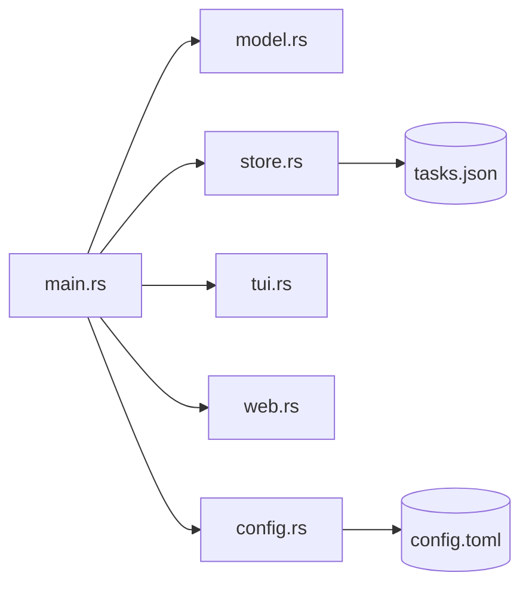

# Architecture

## Modules

| File | Purpose |
| --- | --- |
| `src/main.rs` | CLI parsing (clap), command dispatch |
| `src/model.rs` | `Task`, `Status`, `Priority`, `ProjectData`, `AppConfig` |
| `src/store.rs` | JSON load/save, atomic writes, find helpers, export |
| `src/config.rs` | Config load/save to platform config dir |
| `src/tui.rs` | Ratatui Kanban board |
| `src/web.rs` | Axum server, REST API, embedded assets |
| `build.rs` | Windows icon embedding |

## Data Flow

## Storage

- Tasks: platform data dir via `dirs` crate, path from `store::path()` or `$TASKLYNX_HOME`
- Config: platform config dir via `dirs`, `config.toml`
- Atomic writes: write to `.tmp` then rename

[Back to README](../README.md)
