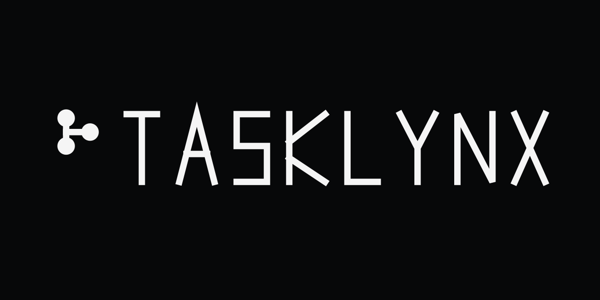

# Tasklynx

> Developer-first local task manager — Rust, terminal UI, Kanban board, Git-style branches, JSON persistence, responsive terminal-style web dashboard.

[](https://github.com/peekstore/tasklynx/actions/workflows/ci.yml)
[](https://github.com/peekstore/tasklynx/actions/workflows/release.yml)
[](LICENSE)

## Overview

Tasklynx is a local-first, keyboard-driven task manager built in Rust. It combines the speed of a CLI with a ratatui-powered terminal Kanban board and a beautiful, responsive terminal-inspired web dashboard. All data is stored locally as atomic JSON — fully inspectable and version-controllable.

## Key Features

- **CLI & TUI** — `tasklynx` (alias `tx`) CLI with Kanban board (`tx board`)
- **Git-style workflow** — Branches for organizing tasks per context (`tx branch`)
- **Local-first storage** — Atomic JSON writes to platform data directory
- **Projects, tags & priorities** — Organize with projects, tags, low/normal/high/urgent priorities
- **Deadlines & agenda** — Due dates with overdue detection, `tx today`
- **Search & stats** — Full-text search, project/tag/status filters, productivity stats
- **Task operations** — Add, edit, complete, reopen, doing, duplicate, delete
- **Export** — JSON and Markdown export
- **Web dashboard** — Embedded Axum server with responsive terminal UI
- **Cross-platform** — Linux, macOS, Windows, Android (Termux)
- **Single binary** — All web assets embedded at compile time

## Quick Start

### Install

**Linux / macOS:**
```bash
curl -fsSL https://raw.githubusercontent.com/peekstore/tasklynx/main/installer.sh | sh
```

**Windows (PowerShell):**
```powershell
irm https://raw.githubusercontent.com/peekstore/tasklynx/main/installer.ps1 | iex
```

### Usage
```bash
tx init
tx add "Fix login bug" --project website --tag bug,auth --priority high
tx list
tx board
tx web
```

## Documentation

- [Getting Started](getting-started.md) - Installation and first steps
- [CLI Reference](cli.md) - Complete command reference
- [Configuration](configuration.md) - Config options and theming
- [Development](development.md) - Building and contributing
