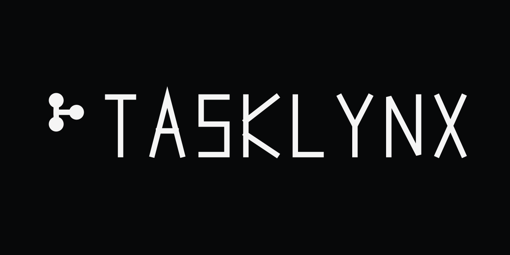
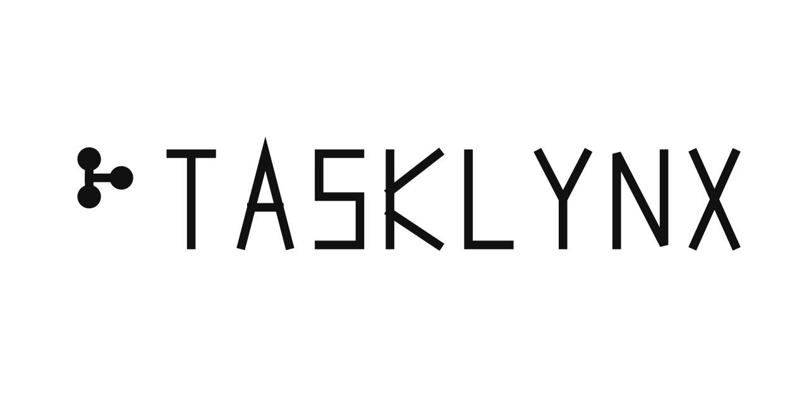

<div class="tasklynx-banner-container">
  
  
</div>

# Tasklynx Documentation

Tasklynx is a local-first task manager for developers. It combines a scriptable CLI, an interactive terminal Kanban board, and a small web dashboard on top of a single JSON store — with Git-style branches for parallel work.

- **Version:** 0.0.1-b4
- **AI Reader:** [`llms.txt`](https://peekstore.github.io/tasklynx/llms.txt) · [`llms-full.txt`](https://peekstore.github.io/tasklynx/llms-full.txt)
- **License:** [MIT](https://github.com/peekstore/tasklynx/blob/main/LICENSE)
- **Repository:** [github.com/peekstore/tasklynx](https://github.com/peekstore/tasklynx)
- **Releases:** [github.com/peekstore/tasklynx/releases](https://github.com/peekstore/tasklynx/releases)

## Current release

[`v0.0.1-b4`](https://github.com/peekstore/tasklynx/releases/tag/v0.0.1-b4) is the current prerelease. It includes:

- Git-aware branches, commit/PR/issue links, TODO scanning, and opt-in commit trailers.
- Optional AI plan, breakdown, triage, standup, review, and ask commands that preview before writing (provider support requires a source build).
- Recurring tasks, dependencies, subtasks, saved views, bulk completion, undo, and trash.
- Local time tracking, due-date reminders, and JSON, Markdown, or iCalendar export.
- CLI, terminal Kanban board, and web dashboard with an AI copilot panel.

See the [changelog](https://github.com/peekstore/tasklynx/blob/main/CHANGELOG.md) for release details.

## Start here

| Guide | What it covers |
| --- | --- |
| [Getting Started](getting-started.md) | Install, initialize, and complete your first task |
| [Installation](installation.md) | Every install method, updates, and uninstall |
| [CLI Reference](cli.md) | Commands, flags, and examples |
| [Configuration](configuration.md) | Config file, data paths, saved views, Git, and AI |
| [Git Integration](git-integration.md) | Branch mapping, commit links, scanning, and hooks |
| [AI Setup](ai-setup.md) | Providers, privacy controls, and the optional `ai` feature |

## Understand the project

| Guide | What it covers |
| --- | --- |
| [Architecture](architecture.md) | Modules, data flow, Git, AI, and storage design |
| [Development](development.md) | Build, test, and release workflow |
| [Deployment](deployment.md) | Release artifacts, Pages, and containers |

## Help

| Guide | What it covers |
| --- | --- |
| [Troubleshooting](troubleshooting.md) | Common problems and fixes |
| [FAQ](faq.md) | Frequently asked questions |
| [Screenshots](screenshots.md) | Interface previews |

## At a glance

```bash
# Install (Linux, macOS, Termux)
curl -fsSL https://raw.githubusercontent.com/peekstore/tasklynx/main/installer.sh | sh

# Create and track your first task
tx init
TASK_ID=$(tx add "Ship the prerelease" --priority high --due 2026-12-31 --estimate 120)
tx start "$TASK_ID"
tx next --explain
tx complete "$TASK_ID"
tx agenda --days 14
tx board
```

[Back to README](https://github.com/peekstore/tasklynx/blob/main/README.md)
